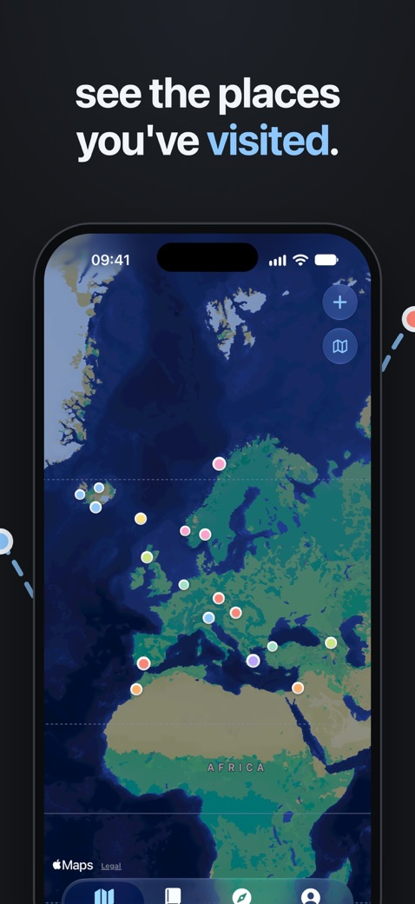
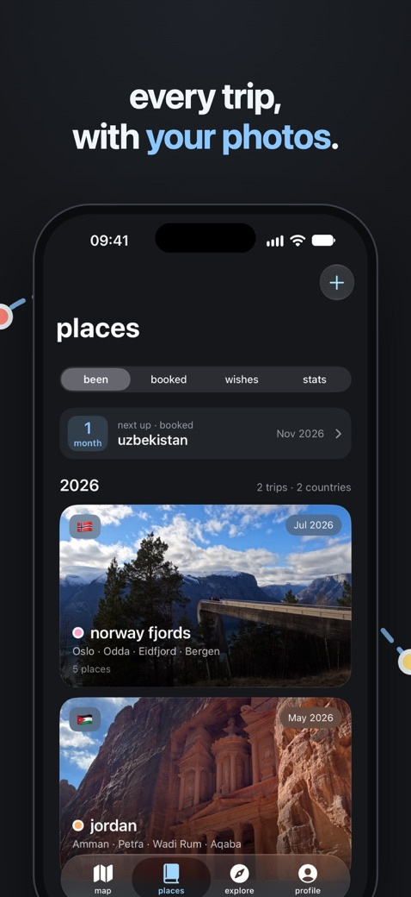
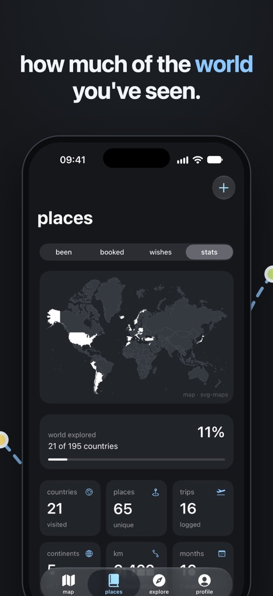
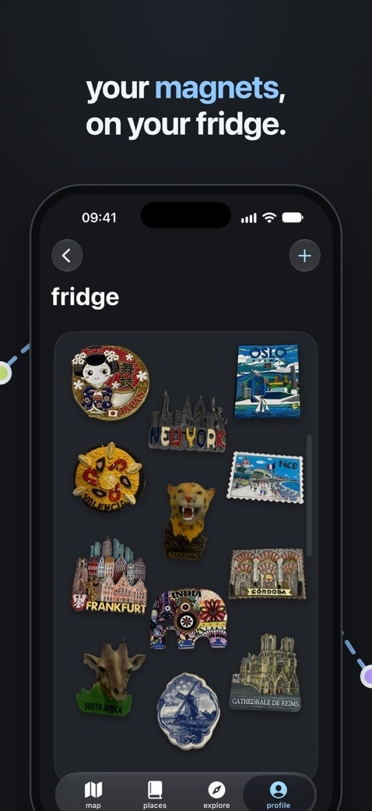

# Yavuzhan Karaoğlan

## dotlas

Gezdiğin ülkeleri ve şehirleri kaydeden, hepsini bir dünya haritasında gösteren iOS uygulaması. Tasarımını ve kodunu tek başıma yaptım; 29 Ekim 2026'dan beri App Store'da.

**[App Store'da dotlas](https://apps.apple.com/app/dotlas/id6816267686)** · [site](https://yavuzhan642.github.io/dotlas/)

  
  
  
  

- **Harita:** her gezinin yerleri haritada kendi renginde nokta olarak görünür (SwiftUI, MapKit).
- **Gezi fotoğrafları:** fotoğraf kütüphanesindeki fotoğrafları gezinin tarihine ve konumuna göre bulur (Photos, CoreLocation).
- **Magnet buzdolabı:** buzdolabı magnetinin fotoğrafından magneti keser ve üstündeki yazıyı okuyup hangi yerden olduğunu önerir (Vision; yazı okuma 1.1'de).
- **Rota videosu:** bir gezinin rotasını paylaşılabilir video olarak çıkarır (AVFoundation, VideoToolbox).
- **Arkadaşla karşılaştırma:** iki kişi birbirinin kodunu kamerayla tarayarak gezdikleri ülkeleri karşılaştırır (VisionKit).
- **İstatistikler ve widget'lar:** Swift Charts, WidgetKit.
- **Spotlight ve Siri:** gezileri Spotlight'ta aranabilir ve Siri'den açılabilir yapar (App Intents, Core Spotlight; 1.1'de).
- Hesap ve sunucu yok; veriler cihazda kalır.

Swift · yaklaşık 18.400 satır · 86 commit (23 Eylül – 30 Ekim 2026). Kaynak kodu kapalı.

## Diğer projeler

| Proje | Ne yapıyor | Teknoloji |
| --- | --- | --- |
| [stay-split](https://github.com/yavuzhan642/stay-split) | Konaklamayı iki tesise bölerek tek otele göre ne kadar tasarruf edileceğini hesaplar | TypeScript, Next.js, Vitest |
| [premier-league-ai](https://github.com/yavuzhan642/premier-league-ai) | Elo puanları ve Poisson regresyonuyla 2026/27 Premier League sezonunu maç maç simüle eder | Python, pandas, scikit-learn |
| [arac-takip-projesi](https://github.com/yavuzhan642/arac-takip-projesi) | Toplu taşıma araçlarının GPS kayıtlarında anomali tespiti, raporlama, REST API ve dashboard | SQL Server, Python, FastAPI, Streamlit |
| [atlaslog](https://github.com/yavuzhan642/atlaslog) | dotlas'ın web prototipi: gezileri hesaplı, etkileşimli bir dünya haritasında tutar | Next.js, Supabase, MapLibre |
